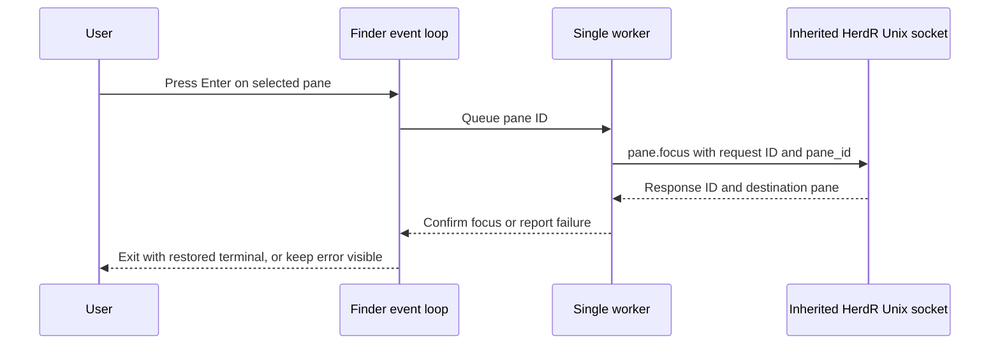

# How Find works

Find turns one HerdR session snapshot into a ranked list of agents and ordinary shells. It runs in its own interactive popup and does not depend on any other plugin.

For example, typing `bapi` can match a terminal titled `Build API`. A query edit selects the highest-ranked match. Arrow keys move selection. Enter from query mode retains the query and returns to navigation; only Enter from navigation queues focus for the selected pane ID. The popup exits only after the focus response confirms the destination. The installed CLI's `pane focus` command accepts a direction, so it cannot implement arbitrary selected-pane focus.

## Components

| Source | Responsibility |
| --- | --- |
| [client.py](../src/herdr_find/client.py) | Injectable snapshot CLI runner, own-popup launch and exact focus over the inherited Unix socket |
| [model.py](../src/herdr_find/model.py) | Snapshot validation, agent/shell records, own-pane exclusion and deterministic result ranking |
| [search.py](../src/herdr_find/search.py) | Case-insensitive subsequence scoring without external tools |
| [renderer.py](../src/herdr_find/renderer.py) | Pure result-to-lines rendering with type/status/context and selected-pane details |
| [app.py](../src/herdr_find/app.py) | Modal query editing, selection, worker polling, resource handover and changed-row writes |
| [resources.py](../src/herdr_find/resources.py) | Explicit selected-directory fd/rg search, previews, open/copy actions and lazygit handover |
| [terminal.py](../src/herdr_find/terminal.py) | Input decoding, terminal size and guaranteed cleanup paths |
| [text.py](../src/herdr_find/text.py), [theme.py](../src/herdr_find/theme.py) | Control stripping, cell clipping and theme/color selection |

Terminal, text, theme and search helpers are small vendored source files that originated from a shared helper set. They are maintained here independently.

## Snapshot to selection

The worker runs one `herdr api snapshot` call per interval, default one second and floor 500 ms. The model validates topology and pane records before replacement, rejects duplicate pane identities, and excludes the pane identified by inherited `HERDR_PANE_ID`. Missing labels use stable IDs. A record without an agent is represented as a shell.

Titles fall back from stripped terminal title to title, label and finally a generic type title. Matching considers title, workspace, tab, kind, cwd and their combined text. Each whitespace-separated query term is matched as a subsequence. Early matches, short gaps and word boundaries improve the score. Equal scores preserve snapshot order. The matcher is greedy and deliberately small; it does not reproduce fzf's algorithm or promise optimal alignment.

Query edits reset selection to the top result. Polls preserve a selected pane while it remains in the filtered results. The renderer scrolls to keep selection visible and clips output to terminal cells. Narrow layouts omit workspace/tab columns while retaining selected details. Complex emoji sequences can have font-dependent widths despite standard-library clipping.

## Exact focus boundary

The client validates the target's `wN:pN` format, uses only `HERDR_SOCKET_PATH`, and sends newline-delimited JSON over AF_UNIX. It reads at most 1 MiB for the response line and verifies the request ID and `result.pane.pane_id`. There is no socket discovery, cross-session fallback or TCP connection. A missing inherited socket fails closed. Request construction and split response reads are covered by a local stub test; the real server response and popup focus are checked manually.

Snapshot and focus work share one background worker with two-second I/O timeouts. Rendering and input stay on the main thread. An explicit focus waits for any active snapshot, then takes priority. Errors retain the last valid records and allow retry. Scrollback reads run on the same worker. No key or prompt is injected.

## Terminal and data lifetime

Rendering strips control sequences, compares lines and writes only changed rows. Resize causes a full clear and preserves query/selection. SIGINT, SIGTERM, Ctrl-C, Escape and unexpected exceptions restore input settings, cursor, wrapping and alternate screen. SIGKILL cannot be caught. A running request may finish during exit, bounded by its timeout.

There are no preferences, history files, logs or disk caches. Scrollback has a temporary in-memory cache. Terminal metadata and query text stay in memory and are cleared on exit. The palette reads only theme colors from HerdR's configuration. Project files are read only through explicit directory search/preview actions. Saved agent histories and credential configuration are not scanned automatically. Opening its own popup and explicitly focusing the selected pane are the only mutations.

See [verification](VERIFICATION.md) for test coverage and the manual checks.

## Content search

The selected pane is read for a preview even without a query. On a nonempty query, the same worker reads one unattempted pane at a time, excluding the finder itself. Snapshot polling and explicit focus retain priority. Each read requests recent-unwrapped text, at most one million lines, with a two-second timeout. Successful lines stay in memory; failed reads contribute to the unavailable count. Closed panes are removed from the cache. Ctrl-R clears attempted reads and content. Matching runs over metadata and individual content lines, retaining the best matching line as a snippet. Results are cached across unchanged frames. Content reads do not access saved conversation files.

## Resource transition and action boundary

Normal-mode f/d/s hands the selected terminal cwd to the resource picker. The root is shown explicitly; it changes only by user directory navigation. The resource worker owns fd/rg scans, previews, clipboard requests and Git-root discovery. Every scan/preview carries a generation and selection; stale results are discarded. A five-second subprocess timeout bounds filesystem tools, and query edits debounce for 150 ms. fd limits paths to 5000, display limits results to 500, rg limits matching lines to 20 per file, and file preview reads cap at 256 KiB.

Only user actions can request editor/system-open/clipboard/lazygit behavior. Main exits the raw-mode context before an interactive app is launched. Editor argv comes from shlex-parsed VISUAL/EDITOR, never shell execution. git rev-parse resolves a repository before lazygit opens; no Git mutations are automated. Returning with t/q/Escape recreates terminal search. Tests use real temporary fd/rg/Git fixtures, injected clipboard/app runners and a real resource PTY. Native focus, clipboard and app behavior are checked manually.
